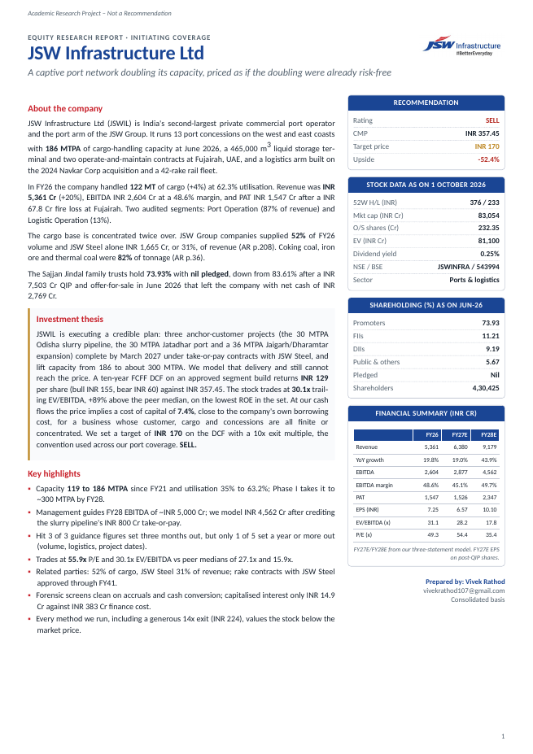
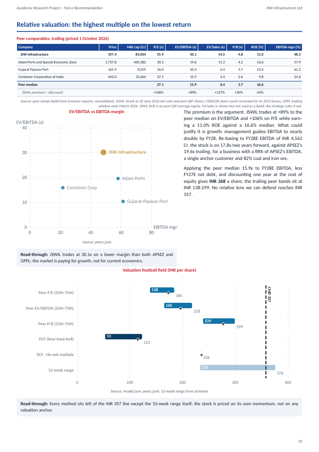
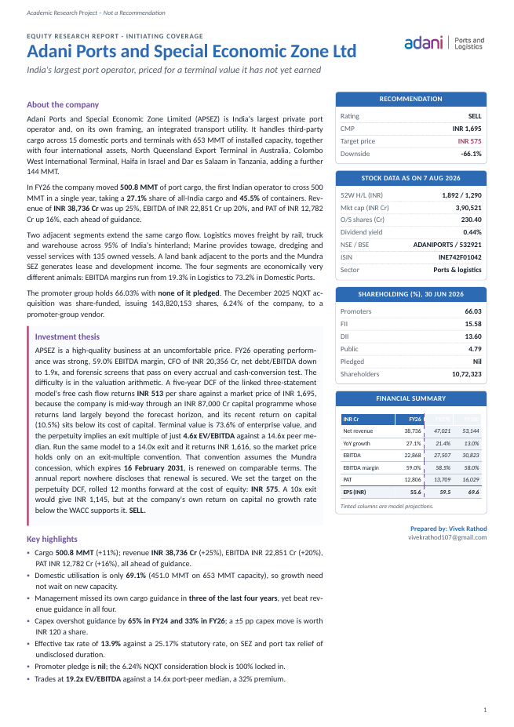
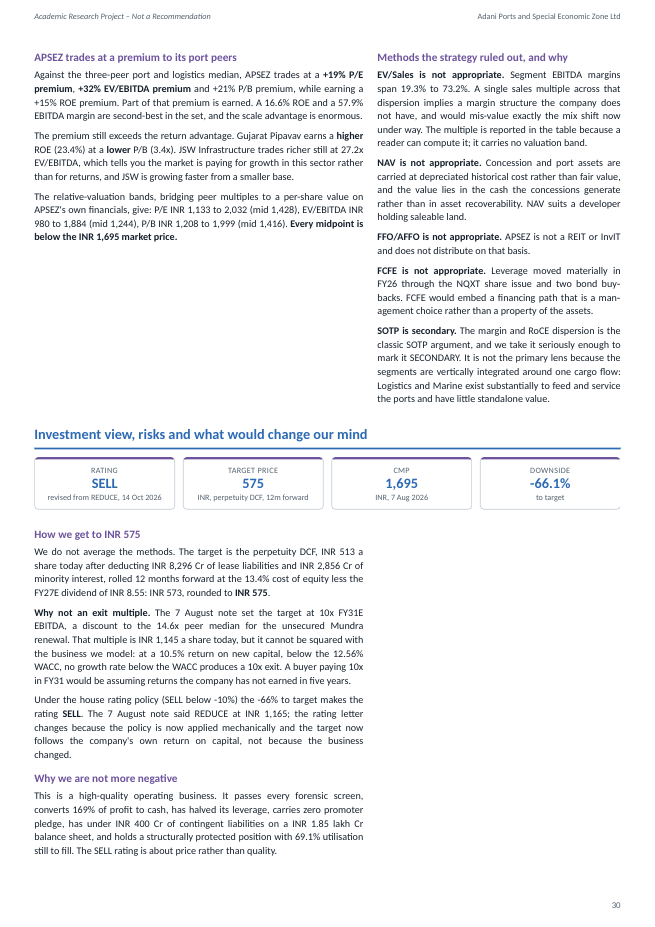
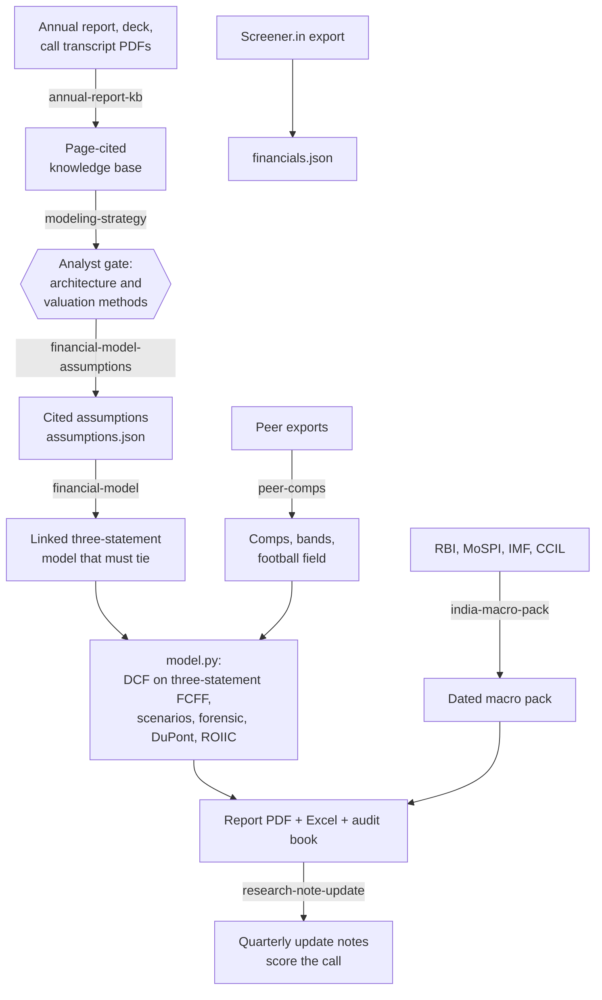

# ERIP: Equity Research Intelligence Pipeline

An AI-assisted pipeline that turns a listed Indian company's own filings into a sell-side style
initiating-coverage report: a 20 to 35 page A4 PDF, a linked Excel model, and an audit trail that
cites every forecast assumption to a page.

It runs as a set of [Claude Code](https://claude.com/claude-code) skills. Each stage owns one
artefact and hands it to the next, and the analyst approves the business architecture and the
assumptions before any valuation is computed.

> **Academic research project. Not investment advice.** See the [disclaimer](#disclaimer).

**[Open the live valuation page](https://spectrablaze.github.io/erip/)**: the call for each company, and the same DCF the reports use, recomputed in your browser as you move WACC, terminal growth, the exit multiple and the scenario.

---

## Sample output

| Company | Rating | Target | Price at cover | Report | Model | Audit trail |
|---|---|---|---|---|---|---|
| **JSW Infrastructure Ltd** (JSWINFRA) | SELL | INR 130 | INR 357.45 (1 Oct 2026) | [PDF, 22 pp](reports/JSWINFRA/JSW%20Infrastructure%20-%20Equity%20Research%20Report.pdf) | [Excel, live formulas](reports/JSWINFRA/JSW_Infrastructure_Ltd_ERIP_Model.xlsx) | [assumptions, strategy, comps, macro](reports/JSWINFRA/audit/) |
| **Adani Ports and SEZ Ltd** (ADANIPORTS) | SELL | INR 575 | INR 1,695 (7 Aug 2026) | [PDF, 33 pp](reports/ADANIPORTS/Adani%20Ports%20-%20Equity%20Research%20Report.pdf) | [Excel, live formulas](reports/ADANIPORTS/Adani_Ports_and_Special_Economic_Zone_Ltd_ERIP_Model.xlsx) | [assumptions, strategy, comps, macro, audit book](reports/ADANIPORTS/audit/) |

<table>
<tr>
<td></td>
<td></td>
</tr>
<tr>
<td></td>
<td></td>
</tr>
</table>

### What the JSW Infrastructure note argues, in brief

- The FY27-FY28 build-out is lower-risk than it looks: 96 of the 117 MTPA being added is take-or-pay
  capacity for the anchor customer, JSW Steel. The report credits it in full, including the slurry
  pipeline's INR 800 Cr EBITDA disclosed by the CFO.
- Even so, a ten-year DCF of the three-statement model's free cash flow returns INR 115 a share
  today (bull 123, bear 53) after lease liabilities and minority interest. At these cash flows the
  market price implies a cost of capital of about 7%, against a 12.3% CAPM cost of equity and a 7.2%
  risk-free rate: the price needs the business to be discounted almost like a government bond.
- A guidance scorecard built from old earnings-call transcripts shows management hitting 3 of 3
  near-term figures and 1 of 5 set a year or more ahead.
- Four falsifiers, each with a metric, threshold and date, define what would change the view.

### The Excel models

Each workbook is a working model, not a printout of one. History is data; every forecast and
valuation cell is a formula (about 2,000 of them), coloured blue for inputs, black for
calculations and green for links between sheets.

- **Dashboard** first: rating, target, upside, the valuation on the active scenario, value per share by method with a
  chart, and a three-year financial summary, every cell linked into the model. Sheets print to A4 landscape, and formula
  cells are locked (no password) so only the blue inputs can be changed by accident.
- **Scenarios**: one cell switches between base, bull and bear. The revenue-growth, margin and
  capex paths change on the Drivers sheet, and the P&amp;L, balance sheet, cash flow, checks and
  DCF all recalculate.
- **Drivers to Schedules**: a linked P&amp;L, balance sheet and cash flow. A revolver and interest
  on average debt are solved iteratively, and the balance sheet ties in every year of every scenario.
- **WACC and DCF**: free cash flow is built from the statements (EBIT after tax, plus D&amp;A, less
  capex and the increase in working capital), with mid-year discounting, a funded terminal value,
  the forward target and the rating rule, with an exit-multiple cross-check.
- **Sensitivity**: WACC x terminal growth and WACC x exit multiple. Each cell recomputes the DCF.

Before publishing, the build recalculates the workbook in LibreOffice for every scenario and
stops unless each one reproduces the Python model's value with no formula errors.

---

## Valuation policy

Applied the same way in the reports, the Excel models and the web page, and recorded per report in
`decisions.json`:

- **Target** = the perpetuity DCF value per share, rolled 12 months forward at the cost of equity,
  less the next year's dividend, rounded to INR 5. Exit multiples are reported as a cross-check, never
  averaged in. For both companies, a 10x exit would need perpetual growth close to or above the WACC
  at the company's own return on capital. So it isn't used as the target.
- **Rating** follows mechanically from the upside to target: BUY above +15%, SELL below -10%, HOLD
  between.
- **Equity bridge**:
  - start from enterprise value at the date of the net-debt figure;
  - deduct net debt, Ind AS 116 lease liabilities and minority interest at book;
  - add non-operating assets;
  - roll forward to the cover date at the cost of equity.
- **Terminal value** ties growth to reinvestment at the company's own recent return on new capital.
- **Scenarios are a range, not a weighted value.** Bear, base and bull each re-run the full model; no
  probabilities are attached, because none could be evidenced.
- **Stress tests**:
  - Each named shock rebuilds the three-statement model: project delay, margin, capex overrun,
    rates, cargo, and a combined case.
  - Two drivers are moved together.
  - A reverse stress finds the shock that first breaches a leverage reference level.
  - Reference levels are cited (Fitch's 3.5x forecast for JSW; management's 2.5x ceiling for Adani
    Ports). Neither company discloses its loan covenants.
  - Committed project capex is held fixed under revenue shocks.
  - Invariant checks confirm value rises with growth and margin.
- **Ratings are append-only.** A revision adds a new dated version with its reason; earlier versions
  are kept. JSW went from SELL 165 to 130, and Adani Ports from REDUCE 1,165 to SELL 575, as the
  method was corrected, not because either thesis changed.
- **Known check exceptions** (for example, reserve movements from share issues that Screener does not
  record) are listed with their source and size in each workbook's Model info sheet, rather than
  silently tolerated.

## Verification

Every report carries a validation record, shown as a status panel on the
[live page](https://spectrablaze.github.io/erip/) and saved in its `audit/` folder:

- **Citations** (`citation_check.json`): every evidence quote is checked against the page it cites,
  in the knowledge base or the original PDF or spreadsheet. Each gets a grade: verified word for word,
  numbers only, checked by eye with a dated sign-off, or external. External means a web source that
  can't be checked offline, flagged when it lacks a URL.
- **Sources** (`source_register.json`): every input document is SHA-256 hashed with its page count and
  date. Each knowledge base is confirmed to be built from that exact file.
- **Model and call** (`validation.json`): three-statement checks, with any exceptions explained; the
  Excel model recalculated in LibreOffice against every scenario; no model output typed into the
  report text; and the standing call in the ledger equal to the model's target.

A git `pre-push` hook (`hooks/pre-push`) runs the pipeline self-test and every report's validation,
and refuses the push if anything fails.

- **Evidence types**:
  - Every piece of evidence is labelled: a reported figure, management guidance, long-range ambition, a
    third-party forecast, market data or an analyst convention.
  - Each report states which forecast drivers rest only on ambition. For Adani Ports, revenue and
    margin rest on the Ambition 2031 targets.
- **Engine tests anyone can run** (`skills/equity-research-report/tests/run_tests.py`, run by GitHub
  Actions on every push):
  - The DCF is checked against closed-form answers.
  - A fully synthetic company's three statements are checked identity by identity.
  - A golden end-to-end value guards against silent changes.
  - No source documents are needed.
- **Track record** (`reports/price_ledger.json`, shown on the live page):
  - Each original call is marked against the NIFTY 50 from its date, in an append-only ledger.
  - Calls are scored only at their 12-month horizon; until then the marks are interim, and they
    include calls that are currently going the wrong way.

## How it works



Nine phases, each ending in a checkpoint:

| Phase | Output | Gate |
|---|---|---|
| 0 Recall and profile | Knowledge brief from previous reports, company profile, peer proposal | Analyst confirms entity and peers |
| 1 Scope | Document checklist with the company's real filing URLs | Documents supplied |
| 2 Knowledge base | Page-level markdown, tables, classified images, brand palette | Palette approved |
| 3 Model | Modelling strategy, cited assumptions, comps, three-statement model, valuation | **Analyst approves the architecture, then the assumptions** |
| 4 Macro | Dated, staleness-audited macro and industry figures, reconciled into the WACC | |
| 5 Charts | 19 charts generated from the data files, never typed in | |
| 6 Write | Report HTML assembled from the data, every claim numbered or cited | |
| 7 Verify | Layout gate (page fill, clipping), 7pt type audit, figure tracing, workbook reconciliation | All gates pass |
| 8 Retrospective | Call, falsifiers and lessons written back for the next report | |

### Design choices that separate it from a template

- **The architecture is decided before the numbers.** A modelling-strategy stage classifies each
  segment's economics (capacity x utilisation x realisation, volume x price, order book, and so on)
  and which valuation methods fit, and can refuse a company outright (banks, NBFCs, insurers).
- **Every assumption carries a page citation and a confidence level**, or is declared "not enough
  evidence" instead of being guessed.
- **The valuation is dated and the terminal value is funded.** Cash flows are discounted from the
  date of the net-debt figure, with a stub for the rest of the first year, and equity is rolled to the
  cover date. The terminal value ties growth to the reinvestment that pays for it, at a return on new
  capital anchored to the company's own recent ROIC.
- **The DCF has to fund itself.** It discounts the free cash flow of a linked P&amp;L, balance sheet
  and cash flow that tie every year, and each scenario re-runs that model rather than nudging a
  margin. The Excel model carries the same calculation as live formulas.
- **Methods are reconciled, not averaged.** Where the DCF and the multiples disagree, the report
  says why; a reverse DCF shows what the price assumes.
- **Forensic screens are interpreted, not printed**: accruals, cash conversion, capitalised interest,
  Altman Z' and Piotroski with the failed tests named.
- **The loop closes.** Each call is logged with falsifiers and a review date; update notes score it.

---

## Repository layout

```
skills/
  equity-research-report/        orchestrator: phases, model.py, charts, render, QA gates
  annual-report-kb/              PDF -> page-cited knowledge base
  modeling-strategy/             segment architecture and valuation-method gate
  financial-model-assumptions/   evidence-cited forecast assumptions
  financial-model/               linked three-statement model (live-formula Excel)
  peer-comps/                    comps table, relative-valuation bands, peer betas
  india-macro-pack/              dated macro figures with staleness audit
  research-note-update/          quarterly update notes that score the standing call
reports/
  JSWINFRA/                      report PDF, Excel model, charts, audit trail
  ADANIPORTS/                    report PDF, Excel model, charts, audit trail
docs/img/                        report previews
```

Source documents (annual reports, Screener exports) and the derived knowledge bases are not
included: they are third-party material. The audit files cite them by page.

## Running it

Requirements: Claude Code, Python 3.12 with `marker-pdf`, `pypdfium2`, `openpyxl`, `matplotlib`,
`pillow`; WeasyPrint for the PDF (native, or inside WSL on Windows); Node.js for the chart renderer;
LibreOffice Calc with `python3-uno` to recalculate and verify the Excel model (inside WSL on Windows).

```bash
# install the skills where Claude Code can find them
cp -r skills/* ~/.claude/skills/
# chart renderer dependencies
cd ~/.claude/skills/equity-research-report/scripts/erip && npm install
```

Then, in Claude Code: `/equity-research-report <company name>` and follow the phase checkpoints.

---

## Disclaimer

These reports are academic research projects prepared to demonstrate equity research methodology.
They are **not** recommendations to buy, sell or hold any security, are not investment advice, and
do not take account of any person's objectives or circumstances. Figures come from the companies'
public filings and other sources believed reliable, but accuracy is not guaranteed, and the reports
are dated: they do not reflect results or events after their cover dates. The author holds no
position in the securities discussed.

**Author:** Vivek Rathod · vivekrathod107@gmail.com

---

© 2026 Vivek Rathod. All rights reserved. This repository is published for viewing and evaluation. No part of the code or
reports may be reused, modified or redistributed without written permission. For licensing or engagements:
vivekrathod107@gmail.com
